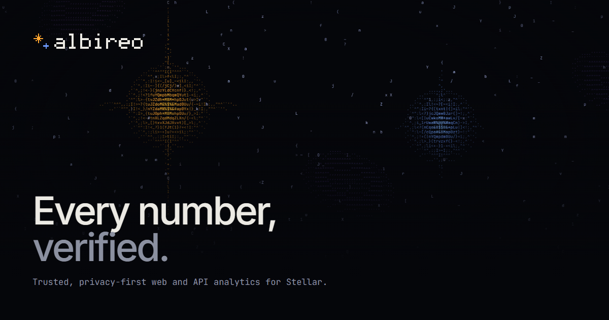

<p align="center"></p>

<p align="center">Trusted, privacy-first web and API analytics for the Stellar ecosystem.</p>

<p align="center"></p>

Albireo is our response to the Stellar Community Fund RFP **Web and API Analytics for Stellar Ecosystem Projects**. SCF reviewers rely on self reported usage today. Albireo gives every Stellar project free, cookieless web and API analytics, collected only from domains the project has proven it owns, filtered for bots, and sealed on Stellar once a day so anyone can check a number was never edited.

Albireo is a double star: one point of light to the naked eye, a gold and a blue star through a telescope. One platform, two layers. Gold is web, blue is API.

## What it does

| | |
|---|---|
| **Web analytics** | Page views, unique visitors, referrers, session duration, bounce rate, country, device and browser. Custom events and an automatic Stellar Wallets Kit funnel. Umami core. |
| **API analytics** | Projects dual export OpenTelemetry. Albireo keeps counters and histograms only: volume per normalized route, status codes, p50 and p95, for 24 months. |
| **Stellar native enrollment** | Wallet sign in through SEP-10, domain proof through SEP-1 `stellar.toml`, DNS or a meta tag. Events from unverified origins are refused. |
| **Daily onchain seal** | Each project summary becomes a SHA-256 leaf, one Merkle root per day is written with `manage_data`, inclusion proofs are public. |
| **Inflation resistance** | Origin binding, bot lists, datacenter networks, headless signals, rate limits and anomaly detection, rolled into an open trust score. |
| **Privacy** | No cookies, no IP addresses, no wallet addresses. EU data residency and one click erasure with a signed receipt. |


## This repository

This first milestone is the product front end: the landing site and an interactive demo of the tenant dashboard, the operator view and a verified public card. Demo pages run on deterministic sample data; the public card computes real SHA-256 Merkle proofs in the browser. The ingestion services (collector, OpenTelemetry pipeline, verifier, anchor) follow in the next milestones.

```
src/
  components/   nav, footer, ASCII sky renderer, charts, terminal
  sections/     landing page sections
  pages/        landing, tenant demo, operator view, public card
  lib/          smooth scroll, demo data, Merkle seal, reveal hooks
brand/          logo, brand kit boards, social card, mark source
scripts/        brand.mjs regenerates brand/logo from brand/mark.js
```

## Run

```bash
npm install
npm run dev       # http://localhost:5173
npm run build     # type check and production build
npm run brand     # regenerate logo files
```

Stack: Vite, React, TypeScript, Tailwind CSS, GSAP ScrollTrigger and Lenis. Fonts are self hosted through Fontsource.

Routes: `/` landing, `/demo` tenant dashboard, `/operator` operator view, `/p/:slug` public card.

The tracker host `a.albireo.dev` in the snippets is a placeholder until hosting is final.

## License

MIT
