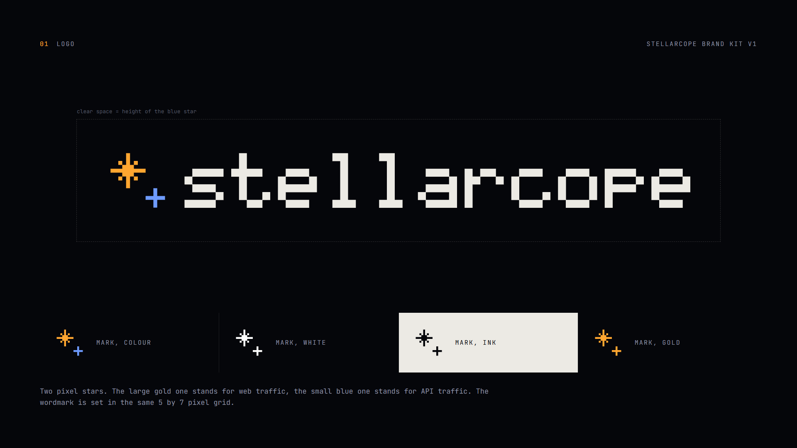

# Stellarcope brand kit



## Contents

```
logo/       mark and lockup in colour, white, ink and gold, SVG and PNG, plus the app icon
kit/        01 logo, 02 colour, 03 type, 04 usage, 05 applications (1920 x 1080)
kit/kit.html  source of the boards, kit/src holds the screenshots they use
social/     og.png, the 1200 x 630 social card, and og-16x9.png at 1200 x 675
mark.js     the pixel cells of the mark and the wordmark, shared by the site and the generator
```

Regenerate the logo files with `npm run brand`. Boards are captured from `kit/kit.html` at their native size.

## Idea

Stellarcope is a telescope pointed at Stellar. What looks like one star to the eye splits into a gold and a blue star through the scope. The product is one platform with two layers. **Gold is web, blue is API**, everywhere, always.

The visual language comes from the Eye of Creation renderer: imagery drawn as coloured ASCII glyphs on deep space, each glyph picked by how much light lands on its cell, with a slow shimmer. The mark and the wordmark sit on the same pixel grid.

## Colour

| Token | Hex | Role |
|---|---|---|
| Space | `#05060A` | Background |
| Panel | `#0B0D14` | Surfaces |
| Ink | `#ECEAE4` | Text |
| Mute | `#8B90A0` | Secondary text |
| Dim | `#565B69` | Tertiary text |
| Gold, large star | `#FFA630` | Web, primary action hover |
| Blue, small star | `#6E9BFF` | API |
| Signal | `#FF6B5E` | Errors only |

Hairlines are ink at 10% opacity.

## Type

- **Inter Variable** for display and text, tight tracking on large sizes.
- **JetBrains Mono Variable** for labels, numbers and data, tabular figures.
- Glyph ramp for ASCII imagery: `` .'`^",:;Il!i><~+_-?][}{1)(|/tfjrxnuvczXYUJCLQ0OZmwqpdbkhao*#MW&8%B@$``

Both faces are self hosted. No font CDNs, the product is privacy first.

## Rules

Do

- Show state with brackets: `[ OK ]`, `[✓]`, `[ Web ]`
- Square corners, hairlines and space to separate
- Draw imagery in glyphs, lit by the two stars
- Short plain sentences joined with commas and full stops
- Numbers in mono with tabular figures
- Slow, eased motion: Lenis lerp 0.075, GSAP power3 and power4 out, respect reduced motion

Don't

- Pills or fully rounded chips and buttons
- Coloured accent lines under headings or beside cards
- Decorative dots, status dots or dot separators
- Em dashes in any copy
- Gold for API data or blue for web data
- Gradients, glows or shadows on the logo

## Voice

Calm, exact, verifiable. Say what is measured and how. Never claim a number you cannot prove.
