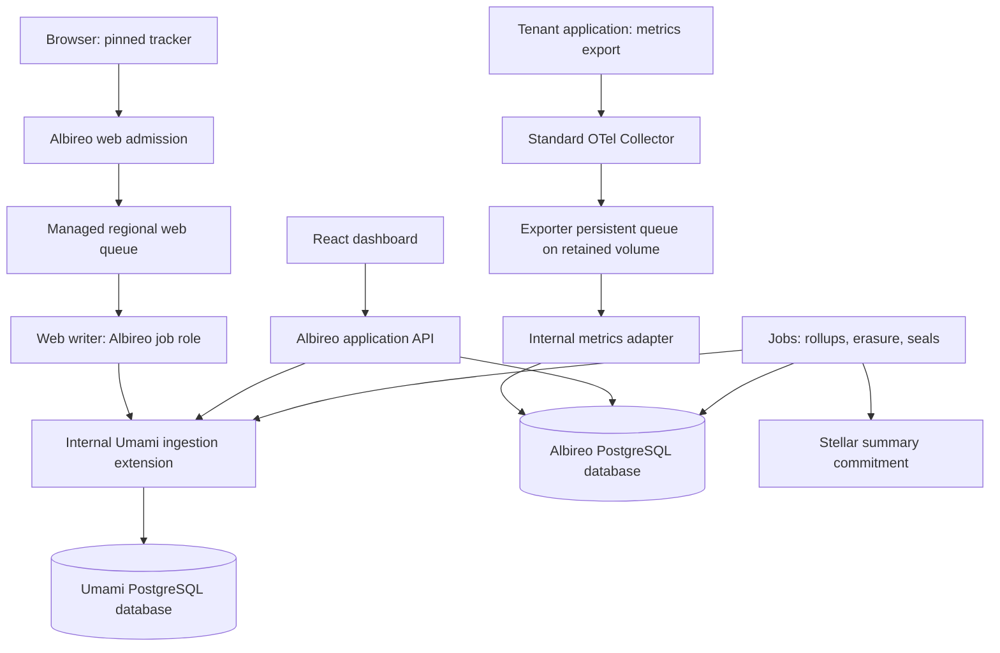

# Albireo architecture proposal — 15 November 2026

Status: **historical proposal**, superseded where choices differ by the [selected technical baseline](2026-11-15-decisions.md). In particular, the selected deployment uses stateless Collector admission into a managed metric queue and a narrow transactional Umami schema adapter. The earlier proposal and experiments remain evidence of how those decisions evolved; the running application has not been migrated.

## Intent and constraints

Build a service another community operator can maintain: one clear owner for each metric, explicit failure behavior, and few custom components. Preserve useful TypeScript/React code. Keep tenant isolation and privacy at admission boundaries, and make retry/restart behavior understandable before pursuing scale.

The [SCF RFP](https://stellar.gitbook.io/scf-handbook/scf-awards/build-award/rfp-track) requests a shared analytics service based on Umami or GoatCounter, frontend web collection, lightweight OTLP-derived API metrics in PostgreSQL, tenant/operator access, self-service enrollment, operational handover, and 24-month API aggregates. It gives expected targets of 99.99% ingestion and 99.90% dashboard availability. Specific commitments remain a proposal decision. This document addresses technical architecture, not submission ownership.

No backend rewrite, Kafka cluster, Kubernetes control plane, custom message broker, or second web analytics engine is proposed. No benchmark has shown a language-runtime bottleneck. Analytics integrity means honest collection and processing guarantees; a Stellar seal can prove a published summary was not edited, not that every visitor was real or every event arrived.

## Current architecture and gaps

| Existing code | Actual behavior | Consequence |
|---|---|---|
| `api/e.ts` | Returns through the collector before `waitUntil(persist(...))` completes | A 202 does not prove a database commit. |
| `services/collector/server.ts` | Catches ingest errors and returns 202 | Callers cannot distinguish failed storage/admission from accepted work. |
| `services/shared/spool.ts` | Buffers 200ms, then appends a local file | Process loss before flushing loses data; this is not an HA durable queue. |
| `services/writer/writer.ts` | Commits rows, then deletes a spool file | A crash between those steps can duplicate effects on replay. |
| `services/api/stats.ts` | Custom web/session SQL | The current system is not using Umami as its web analytics foundation. Visitor/day grouping is not Umami visit semantics. |
| `services/api/http.ts` | Custom per-request self-metric writes | Useful prototype, not tenant OTLP support. |
| `packages/core/histogram.ts` | Assumes a finite last-bucket upper bound | A 100-second sample currently yields a misleading 19.5-second p95. |
| API routes and `db/schema.sql` | Public-card reads and schema scaffolding; no full member/operator authorization path or RLS | Database tables for API keys do not establish authentication or tenant isolation. |

The standalone and serverless deployment paths also differ in visitor-salt handling. Unify behavior behind domain functions and contract tests rather than maintain two ingestion implementations. The current landing/README claims should be reconciled with delivered functionality before promising compliance or availability.

## Approaches and tradeoffs

| Approach | Strength | Cost / limit | Position |
|---|---|---|---|
| A. Internal Umami + synchronous web commits; Collector's persistent queue for metrics | Fewest infrastructure components; successful web response means commit | Web admission fails during Umami/database outages; browser retries are bounded and page-exit beacons expose no server receipt | Sensible pilot or explicitly weaker availability commitment. |
| B. A plus a managed, independent web queue | Web admission can survive downstream outages; avoids owning another filesystem spool | Adds queue operations, replay/erasure rules, and a trusted Umami ingest extension | **Recommended production direction when pursuing the stated ingestion target.** |
| C. One new streaming platform for all traffic | Shared routing and a possible future high-throughput backbone | Duplicates Collector buffering and increases operational scope before a need is measured | Defer. |

Recommendation B is based on the desired failure boundary, not a local proof that a particular cloud queue meets four nines. A broker still delivers duplicates and cannot repair incorrect metric state. Provider choice, monthly cost, and the actual end-to-end SLO must be validated before a production commitment. A is the fallback if scope/operating budget cannot support B; document the weaker behavior rather than acknowledging unsaved events.

For planning, the proposed first production release is **B**, supporting stable HTTP **explicit histograms in delta and cumulative temporality**, with monotonic request counters as a fallback. Exponential histograms, arbitrary gauges, and general APM are outside that initial profile. Cumulative histogram conversion is therefore a required implementation item, not something this proposal assumes the integer-counter fixture has finished. A smaller delta-only pilot is a separate scope change.

## Proposed data flow

The two databases can initially share one managed PostgreSQL cluster with separate databases, roles, and migrations. That saves operations and cost while sharing the cluster's failure domain. The web queue is independent of that cluster. The metrics adapter can run from the same TypeScript codebase/image as the application; process roles separate scaling and credentials without requiring independent repositories.

## Ownership and trust boundaries

**Umami owns web events and web metric definitions.** Albireo owns tenant enrollment, memberships, verified domains, API credentials, abuse rules, privacy policy, API aggregates, collection-health reporting, and seals. Albireo maps tenant/site IDs to Umami website IDs on the server. Read web reports through a restricted adapter; never let a browser choose arbitrary Umami website IDs under an operator credential. Avoid storing a second raw web dataset in Albireo.

**Albireo's application is modular, not a new collection of microservices.** Recommended modules are enrollment/access, web admission, Umami integration, API metrics, reporting, and jobs. A small schema-driven HTTP framework such as Fastify is reasonable to reduce manual parsing/validation/auth plumbing. Keep SQL and existing core logic where they remain correct. Separate modules by responsibility; split deployment only for scaling, storage, or credential needs.

**Standard Collector owns public OTLP handling.** Support metrics-only tenant export to our endpoint. The lab rejects `/v1/traces` and `/v1/logs` with 404; it does not silently accept or store them. Publish this endpoint contract and tenant export examples. If broader dual-export clients require successful discard responses, add bounded discard-only receivers as an explicit compatibility change, with no persistence and its own abuse limits.

**Authentication precedes attribution.** For Collector ingestion, use signed tenant credentials with pinned issuer/audience and a required tenant claim, verified locally. OIDC is a viable standard component and was exercised in the lab. Overwrite all untrusted tenant attribution and copy only the verified tenant ID into the sanitized resource before persistence. The private adapter trusts this field only from the authenticated Collector network path, never arbitrary public POSTs.

Proposed production credential policy: 24-hour tenant ingestion tokens, public-key rotation with overlap, and a signed tenant revocation/suspension snapshot refreshed every minute and valid for at most five minutes. Public keys and the last valid snapshot are cached locally; existing credentials therefore need no per-event database lookup. If the snapshot becomes too stale, fail closed and count the failure against availability. Token issuance/renewal and cold-start configuration need independent availability checks. This policy and enforcement beyond basic JWT validation are **proposed and untested**; implement and exercise expiry, missing-claim, rotation, and suspension behavior before production.

The control plane retains API-key hashes/scopes for enrollment/renewal. Dashboard membership and operator permissions are separate from ingest credentials. Use a dedicated privileged role for operator actions, audit it, and keep ordinary tenant queries under non-owner RLS policies. A trusted writer may process many tenants but must set transaction-scoped context per tenant when using tenant-constrained tables. Credentials that choose tenant context are part of the trusted boundary; RLS does not replace authorization.

For human access, preserve the repository's intended Stellar wallet sign-in using [SEP-10](https://github.com/stellar/stellar-protocol/blob/master/ecosystem/sep-0010.md), implemented with maintained SDK verification helpers rather than custom signature logic. Proposed browser sessions use secure HttpOnly cookies, CSRF protection, and server-side membership checks. Keep login identity in the protected control plane, separate from anonymous analytics. A successful first enrollment creates a tenant and owner membership atomically; ownership of a domain is verified before web admission. Owners add/revoke members through expiring, single-use invitations; an operator role is provisioned administratively and cannot be self-selected. Wallet recovery/owner transfer requires an audited operator process. These are author recommendations, not functionality already delivered by the prototype.

## Web admission, delivery, and Umami compatibility

Assign a fresh browser event ID per intentional action and reuse it only for that action's retries. The gateway bounds size/rate/time skew, verifies the site-to-domain mapping, applies abuse/privacy rules, and attaches the trusted tenant/site. Domain proof and Origin checking reduce accidental/misconfigured submissions; a public tracker ID and browser headers are not a secret and do not prevent all spoofing.

Return success only after the chosen durable admission point: the managed queue's successful publish in B, or a completed database transaction in A. Queue failures produce retryable responses. Queue acceptance does not mean the dashboard is already updated. Browser SDK retries need backoff/jitter, bounded memory, and bounded time. Page-exit collection remains best effort.

The verified site/domain registry must also be available without a per-event database lookup. Use the same bounded-staleness admission snapshot/cache policy as tenant suspension, with a proposed five-minute maximum age. Missing or stale authorization state fails closed. Test warm admission and cold starts independently: adding a queue does not remove database dependencies that remain in registry lookup, credential renewal, or configuration bootstrapping.

**The unmodified Umami `/api/send` endpoint is not safely idempotent.** The real-image tests produced two rows from one committed event followed by a retry. A gateway receipt around an upstream HTTP call cannot be atomic with Umami's write. Umami's `payload.id` is visitor identity, not a request idempotency key. [Pinned write implementation](https://raw.githubusercontent.com/umami-software/umami/v3.5.0/src/queries/sql/events/saveEvent.ts)

A narrow trusted ingestion extension is therefore a production gate, preferably contributed upstream. It must store the tenant/site-scoped event ID, a canonical payload fingerprint, the event, session/visit effects, and event properties in one transaction where applicable. A duplicate with the same fingerprint returns the original successful result; changed content is a conflict. Do not maintain a large UI fork. Test this extension against upstream upgrades; the fixture's receipt tables do **not** implement it.

Queueing also changes identity preparation. Do not replay sanitized events through normal `/api/send` using the worker's IP or current time: that corrupts visitors and visits. For anonymous tracking, use a versioned extraction of Umami's own pure session resolver at admission, verify/return its cache token, and carry resolved session/visit context plus the original event time in the trusted envelope. Disable visitor `identify` and client-supplied identity/salt paths. Keep the resolver and internal extension at the same upstream revision. Raw IP/UA may be used transiently for filtering/derivation, but must not be placed on the queue or in access logs. Country-only metadata is allowed; city/region enrichment is disabled.

That shared resolver seam is an implementation proposal, **not yet compatibility-proven**. Before choosing it for production, test first visit, inactivity expiry, midnight salt rotation, missing/stale cache, concurrent first events, and delayed/out-of-order delivery against upstream behavior. If it requires a broad fork, stop and reassess the tradeoff; do not quietly build an independent session engine.

Use bounded retries and an operator-visible quarantine for poison messages, with alarms before retry/retention exhaustion. A managed queue's dead-letter facility is transport-specific and must be configured/tested. The worker acknowledges a message only after the idempotent database result. Receipt lifetime, queue retention, retry age, and deletion tombstones must be consistent. Proposed initial maximum replay age is seven days, receipts eight days, subject to provider retention/capacity validation.

## Metric admission and aggregation

Use the tested pipeline order: authenticate → bind tenant and sanitize → persistent exporter queue → queue-integrated batching → internal SQL adapter. The exporter-helper's persistent queue excludes auth-extension context; putting trusted tenant identity into the payload before queueing is essential. [Pinned queue contract](https://raw.githubusercontent.com/open-telemetry/opentelemetry-collector/v0.165.0/exporter/exporterhelper/README.md)

Keep `fsync` and persistent storage explicit. Each Collector replica owns its own queue/volume; replicas must not concurrently share one file-storage database. A process restart can replay a retained queue. Losing its volume loses pending records; another replica preserves new admission, not the first replica's already accepted backlog. The selected platform must demonstrate volume recovery/reattachment and document the accepted RPO. If the storage-loss requirement exceeds this, use an independent replicated admission layer for metrics too, rather than claiming local files provide HA.

Accept the stable HTTP duration histogram and a documented compatibility profile of monotonic request counters. Store tenant, resource/service/instance, scope/schema, name/unit/type/temporality, point times, bounds, counts, and sums needed for correct processing. Canonicalize attribute maps independently of ordering. Use a tenant-scoped canonical point identity and content fingerprint; transactionally insert the receipt and aggregate effect. Deduplication covers the same point replayed, not an SDK generating a new identity for the same underlying observations.

Prefer native delta metrics. For cumulative input, persist the original source points first; convert with a durable per-stream checkpoint in PostgreSQL in the same transaction as receipts and aggregate updates. Preserve instance identity until after conversion and serialize updates per stream. A changed start time establishes a new epoch. An identical previous point is a harmless retry; a conflicting value is rejected. Previously unseen out-of-order or overlapping intervals are quarantined/flagged instead of silently merged. The first point of an unknown already-running stream establishes a baseline and marks the earlier interval incomplete; do not invent historical traffic. Counter-reset and histogram-layout changes require explicit new-baseline handling.

The local durable checkpoint fixture covers **integer counters** with a declared initial-zero policy; full histogram-vector conversion, partial sums, flags, resets and time attribution remain production adapter acceptance work. Prefer a Go exporter over an ever-growing handwritten TS OTLP parser if broad type support is required. Start with a narrow TS adapter behind the standard Collector, using generated protocol types and explicit runtime checks.

Keep compatible histogram vectors; never add arbitrary bucket arrays positionally. Convert seconds/milliseconds explicitly, keep overflow as an unbounded interval, and label estimated percentiles. Count requests from the duration histogram when available, using counters only as a documented fallback. Keep SDK overflow measurements separate from complete route/status breakdowns. Metric timestamps describe source intervals, not arbitrary request arrival times; do not assign a whole long interval to one minute without declaring that approximation.

## Privacy, retention, and reporting

Sanitize **before every durable store**, including queues, disk buffers, quarantine, and logs. Allowlist event properties and metric dimensions; strip URL queries/fragments unless individually approved, wallet/account identifiers, exemplars, raw addresses, and unrestricted user-provided text. Values inside allowed labels also need validation: an allowlist of field names alone is not a privacy strategy. The lab verifies a narrow attribute-removal example, not GDPR compliance.

Keep raw/replay data for the shortest operational window; retain API aggregates for 24 months. Initially use indexed PostgreSQL tables and scheduled rollup/retention jobs; add time partitions when measured size, pruning, or deletion behavior justifies them. Umami keeps its own migration ownership. Albireo needs versioned migrations and one migration runner rather than assuming `CREATE TABLE IF NOT EXISTS` upgrades schemas.

Proposed API retention/reporting contract: minute aggregates for 30 days, hourly aggregates for 24 months, both retaining tenant, service, normalized route, status class, compatible histogram version/bounds, count and sum. The dashboard can derive volume, status/error share, and estimated p50/p95 at those resolutions. SDK instances are retained for conversion/checkpoint identity, then removed from reporting dimensions. Keep accepted source points for seven days, point receipts for eight, and cumulative checkpoints for 30 days after the last point; expired checkpoints establish a visibly incomplete new baseline. Default reports do not promise individual-request queries or minute precision across the full two years. These retention periods need privacy/operator approval before deployment.

Tenant erasure removes live data and caches, revokes admission, and blocks queued replay using a deletion/suspension tombstone checked by writers. Deleted tenant IDs are never reused. If the database is unavailable, the writer waits; it does not skip the tombstone check. Queue purge/quarantine cleanup, backup expiry and restore-time reapplication of tombstones must be part of the erasure runbook. Erasure completion claims must reflect these retention windows.

Only sanitized aggregate commitments go to Stellar. Store versioned summary definitions, finalize after a declared lateness window, and publish revisions explicitly if later corrections are allowed. Proposed initial seal window is 24 hours after day end; events arriving later update a revision instead of overwriting a published commitment. Sealing failures retry from a database job and do not block ingestion. Do not put personal data or reversible identifiers onchain.

## Existing clients and data

Treat the deployed self-measurement site, tracker URLs, public cards, and published proofs as real compatibility surfaces. Preserve their URLs and response shapes through adapters where semantics remain valid. Introduce a new pinned tracker version carrying event IDs; the existing tracker has no retry identity and remains explicitly best effort during a proposed 30-day migration window. Do not fabricate event IDs and claim that historical clients became idempotent.

Mark the Umami cutover timestamp and report-definition version. Keep existing custom web rows read-only for the approved retention period and expose historical reports as legacy data rather than importing them with invented Umami sessions or merging unique visitors across incompatible definitions. Preserve existing Stellar proof verification independently of new summary versions. Inventory external clients before announcing a cutover; this proposal does not authorize deleting historical data or silently breaking an unknown tenant installation.

## Operations, SLOs, and remaining decisions

Proposed ingestion SLI: eligible, well-formed, within-quota requests durably admitted within two seconds divided by such attempted requests, measured separately for web and metrics. Storage/auth-control-plane outages and server overload count as failures; do not exclude valid traffic merely because the queue is full. Retries are visible attempts, not a reason to hide failed initial admission. Validate the latency threshold and traffic profile in staging before adopting it.

Track dashboard availability separately from freshness and completeness. Proposed normal freshness objective is 99% of accepted records queryable within 60 seconds when downstream services are healthy; backlog episodes remain visible. These numerical latency/freshness thresholds are author proposals, not RFP requirements or measured results.

For a 30-day month, 99.99% time availability allows roughly 4.32 minutes unavailable and 99.90% roughly 43.2 minutes. Request-based SLIs have a different denominator. A 15-second local database outage test proves neither monthly target. [SLO design guidance](https://sre.google/workbook/implementing-slos/)

Run stateless app replicas across failure domains, managed database failover/backups, external synthetic admission/read checks, queue age/capacity and rejected/export-failed counters, and visible collection status. Persist accepted/pending/committed/quarantined counts consistently at matching units; aggregate totals and transport attempts are different measurements. Use a database job mechanism for erasure/seals, not another broker solely for cron jobs.

Before an implementation plan or an operational commitment, settle these product/operations decisions against measured staging evidence:

- Hosting region/provider, operating budget, managed web queue, and treatment of storage/zone loss. The proposal recommends regional managed services; it does not select a vendor contract.
- Approval of the proposed first-release B scope, or an explicit reduction to A's pilot scope and limitations.
- Approval of the documented metric/reporting profile and incomplete-interval handling. Cumulative histogram support is a material implementation task.
- Privacy/retention/seal-lateness policies and the responsible operator's support/handover commitments.

Builder discretion covers module filenames, SQL migration tooling, schema library choice, and instance sizing after profiling. The invariants above—durable acknowledgement, verified attribution before persistence, atomic replay handling, correct metric semantics, and honest health reporting—are not optional simplifications.

## Production acceptance gates

1. Implement the trusted Umami extension and validate replay, transaction rollback, properties, sessions, timestamp/identity boundaries, and concurrency against the actual upstream image/build.
2. Exercise real supported tenant SDKs and OTLP JSON/Protobuf input, gzip/limits, cumulative histogram vectors, resets, multiple writers, overflow, and partial-success behavior.
3. Verify tenant authorization, required claims, credential rotation/revocation, RLS, operator access, and erasure across replay/caches/backups.
4. Demonstrate database failover, Collector rolling deploy, disk full, retained-volume recovery and storage/zone loss behavior on the selected platform; verify alarms and quarantine replay.
5. Run a representative sustained load/burst and restore drill with the promised pilot projects. Record actual admission/freshness/error-budget behavior before claiming targets.

The local decision experiment is complete for its stated scenarios. These are deployment and production implementation gates, not claims that the disposable sink is production-ready.

## Review record

A fresh builder review identified four planning ambiguities: first-release ingestion scope, human authentication/enrollment, existing client/data compatibility, and long-term report resolution. This revision supplies author recommendations for all four. They remain proposed choices for discussion; only the internal-Umami direction was selected by the user. No production implementation plan has been executed.
