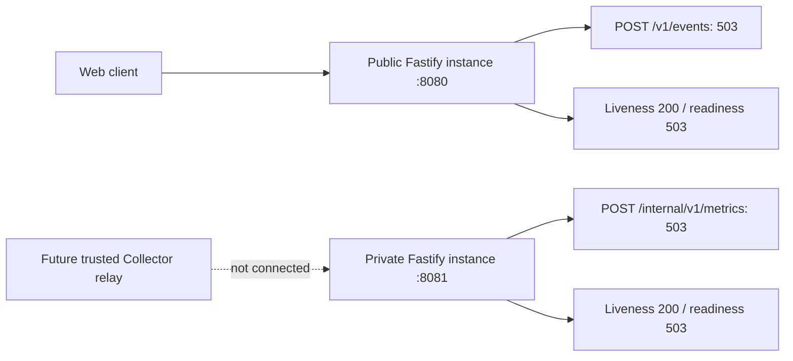

# Ingress skeleton: operations and boundaries

Status: **roadmap step 4 implemented, 16 November 2026**. This service runs independently of the legacy collector/Vercel functions. It performs no authentication, queue publication, database access, metrics normalization or persistence. Registered ingestion placeholders always reject with 503, and readiness is deliberately false.

## Start locally

Use Node 26.13.1 or the tested Node 24.22.3 compatibility floor:

```sh
npm ci
npm run start:ingress
```

The CLI validates configuration before opening sockets, starts the private listener and then the public listener, and logs `Ingress listeners started` after both binds succeed. A bind failure closes any opened listener and exits unsuccessfully. Configuration failures identify the invalid key without echoing its value. Other startup failures, including bind errors, use a generic message. `loadConfig(env)` exposes the safe `IngressConfigError` type for callers.

No `.env` file is automatically loaded, and no database/broker credentials are required. To use another local public port:

```sh
INGRESS_PUBLIC_PORT=8180 npm run start:ingress
```

Stop with Ctrl-C or SIGTERM to the Node process. Both listeners close; repeated programmatic `close()` calls share one promise. The CLI gives shutdown up to ten seconds, then exits unsuccessfully on timeout/failure. It does not manage jobs or broker leases at this stage. Repeating the same signal during a drain can force earlier termination; only programmatic `close()` calls are currently idempotent.

## Two independent listeners



These are distinct Fastify instances with distinct route trees. `Host`, forwarding headers and encoded paths cannot select the other instance. `trustProxy` is false. Both bind to loopback by default.

Binding the private listener to `0.0.0.0` or another non-loopback IP requires deployment-level network restrictions. A separate port is not authorization, and this skeleton supplies no private-listener credentials. Keep it on loopback for local operation; network and admission controls must precede activation.

## Routes and responses

| Method/path | Public :8080 | Private :8081 |
|---|---|---|
| `GET /health/live` | 200 `{"status":"ok"}` | 200 `{"status":"ok"}` |
| `GET /health/ready` | 503 `{"status":"not_ready"}` | 503 `{"status":"not_ready"}` |
| `POST /v1/events` | Structurally valid JSON → 503 `INGESTION_NOT_CONFIGURED` | 404 |
| `POST /internal/v1/metrics` | 404 | 503 `INGESTION_NOT_CONFIGURED`, including bodyless requests |

Liveness proves the process can answer, independently of a database. It does not prove data acceptance or availability targets. Readiness must remain 503 until the later admission path is connected and its readiness criteria are defined. Do not use liveness to route production ingestion traffic into this skeleton.

Admission placeholders send `Retry-After: 60`, never 202 or a receipt. The private placeholder has no OTLP semantic validation yet. The public placeholder reuses [WebEventV1](../packages/ingestion/web.ts), with strict validation: unknown fields such as `tenantId` are rejected, types are not coerced, and fields are not silently removed. Structural validation grants no tenant/site authority and does not replace privacy preparation.

For example, this valid payload still receives 503:

```sh
curl -i http://127.0.0.1:8080/v1/events \
  -H 'Content-Type: application/json' \
  --data '{"version":1,"siteId":"stellarcope","eventId":"9d94ec7c-b593-4632-9880-19d87b7a2875","type":"pageview","path":"/swap"}'
```

Legacy `/e`, tracker URLs, dashboards and existing API functions are not mounted here. Their behavior remains in their original entry points. Experimental `/token`, `/consume` and failure-control routes are absent.

## Configuration

| Environment variable | Default | Accepted values |
|---|---|---|
| `INGRESS_PUBLIC_HOST` | `127.0.0.1` | IPv4 or IPv6 literal; no hostname, brackets or port suffix |
| `INGRESS_PUBLIC_PORT` | `8080` | Integer 1–65535 |
| `INGRESS_PRIVATE_HOST` | `127.0.0.1` | IPv4 or IPv6 literal |
| `INGRESS_PRIVATE_PORT` | `8081` | Integer 1–65535, different from public port even on different hosts |
| `INGRESS_PUBLIC_BODY_LIMIT_BYTES` | `8192` | Integer 1–8192; may only reduce the limit |
| `INGRESS_PRIVATE_BODY_LIMIT_BYTES` | `4194304` | Integer 1–4194304; may only reduce the limit |
| `INGRESS_LOG_LEVEL` | `info` | `trace`, `debug`, `info`, `warn`, `error`, `fatal`, `silent` |

Numbers must be canonical positive decimal strings: empty strings, whitespace, leading zeroes, signs, fractions, exponent notation and non-finite/out-of-range values fail startup. IPv6 values use forms such as `::1`. Other environment variables are ignored by this service.

Trusted programmatic tests pass port zero directly to `startIngress()` for ephemeral sockets. Environment parsing rejects port zero; this testing seam is not an operator configuration option.

## Input limits, errors and logging

- Admission request bodies use JSON. `text/plain` is unsupported in this new service; legacy beacon handling is separate. The private placeholder also returns 503 for a bodyless request; it has no required OTLP body contract yet.
- Compressed bodies are rejected with 415 before decoding. Only absent/identity content encoding is supported, so accepted raw/decoded bytes share the configured limit. The future public Collector's compressed OTLP handling is separate.
- Limits count bytes, including multibyte JSON, rather than JavaScript character length. Oversized input gets 413; malformed JSON syntax, prototype-poisoning or schema-invalid JSON gets 400. Fastify currently decodes malformed UTF-8 inside JSON strings using replacement characters; those inputs may reach the disabled 503 placeholder.
- Service-controlled errors expose `{"code":"…"}` with `INVALID_REQUEST`, `PAYLOAD_TOO_LARGE`, `UNSUPPORTED_MEDIA_TYPE`, `NOT_FOUND` or `INTERNAL_ERROR`. They omit submitted values, exception messages and stacks. Low-level HTTP parser/closing responses may use Fastify's standard generic response shape.
- Normal routed responses use `Cache-Control: no-store`. Malformed-URL framework errors and low-level HTTP responses may omit that header. Declared response schemas project the permitted DTO fields.
- Automatic request logging is disabled through Fastify's `LogController`; request IDs are generated locally. Raw request/response/error serializers are suppressed or redacted, including transport errors at trace level. Unexpected application failures log a static code and generated request ID, not headers, bodies, raw URLs, client IPs or exception text. Static startup/process metadata can still be logged.
- Connection/request timeouts are configured at ten seconds, with five-second keep-alive. These settings are transport controls, not a latency/SLO guarantee.

The defaults and contracts follow the installed Fastify version; see the official [server reference](https://fastify.dev/docs/latest/Reference/Server/) and [validation/serialization reference](https://fastify.dev/docs/latest/Reference/Validation-and-Serialization/). The deliberate strict-validation settings override Fastify's field-removal/coercion defaults.

## Verification and code map

```sh
node --test 'services/ingress/*.test.ts'
npm run check
npm audit
```

The focused suite covers configuration, independent route trees, spoofed headers/encoded paths, byte limits, compression rejection, response/log redaction, prototype input, real TCP listeners, startup rollback, idempotent close and CLI shutdown. The full check also covers the existing application. Tests use local/controlled resources and do not submit a Stellar transaction or require Docker/database credentials.

| File | Responsibility |
|---|---|
| [config.ts](../services/ingress/config.ts) | Pure environment parsing and bounds |
| [app.ts](../services/ingress/app.ts) | Independent route composition, transport policy and safe responses/logs |
| [main.ts](../services/ingress/main.ts) | Listening, startup rollback and CLI lifecycle |
| [config tests](../services/ingress/config.test.ts) | Configuration contract |
| [app tests](../services/ingress/app.test.ts) | Injected HTTP boundary cases |
| [lifecycle tests](../services/ingress/main.test.ts) | Real sockets and child-process lifecycle |

## Recorded follow-ups

These minor follow-ups were identified in review and remain outside this batch's fix pass:

- Add `no-store` to the malformed-URL framework error path.
- Keep repeated same-signal shutdown within the graceful drain guard.
- Decide/enforce strict UTF-8 byte validation before admission is activated.
- Require the private metrics body when its real contract is implemented.
- Extend encoded-private-path coverage from injection to the real-socket test; current TCP checks cover the literal path.

## Stop boundary

Feature work stops here for this batch. Database migrations/RLS, SEP-10 and membership, credentials/registry, privacy preparation, queue publication, Umami worker effects and production metrics processing remain later [roadmap steps](plans/2026-11-15-rollout.md). The service is not connected to the existing Collector experiment or dashboard proxy. Those integrations must not inherit a success/readiness claim from this skeleton.
